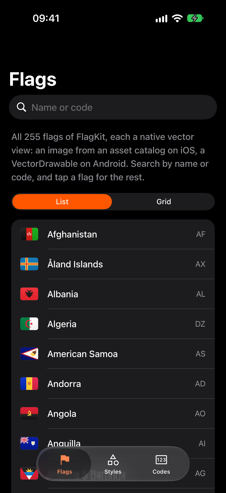
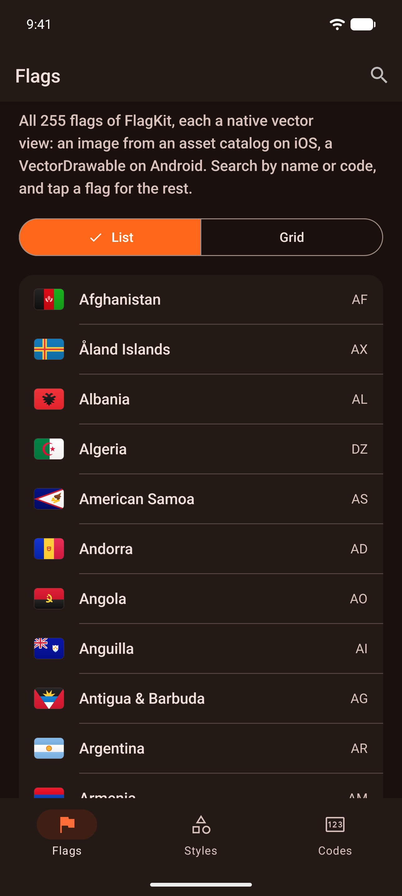

# expo-flags-kit

[](https://www.npmjs.com/package/@hzblj/expo-flags-kit)
[](./LICENSE)

Country flags for Expo as a native view. The 255 flags from [FlagKit](https://github.com/madebybowtie/FlagKit) are drawn as vectors on iOS, Android and web, so they stay sharp at any size, with typed codes, localized names and emoji to go with them.

<p>
  
  
</p>

```sh
npx expo install @hzblj/expo-flags-kit
```

```tsx
import {FlagView, getFlagName, toFlagCode} from '@hzblj/expo-flags-kit'

<FlagView code="CZ" style={{width: 24}} />
<FlagView accessible code="JP" style={{width: 32, height: 32, borderRadius: 16}} />

toFlagCode('gb_sct') // 'GB-SCT'
getFlagName('CZ', 'cs') // 'Česko'
```

**[Documentation](./packages/expo-flags-kit/README.md)**: sizes and shapes, accessibility, codes, names and emoji, and platform behavior.

## This repository

| Path | What lives there |
| --- | --- |
| `packages/expo-flags-kit/` | `@hzblj/expo-flags-kit`, the published package: the JavaScript API, the iOS and Android module, the web view, and the generator that turns FlagKit's SVGs into every platform's assets |
| `apps/example/` | The example app (iOS and Android): every flag, searchable, in a list or a grid; sizes, shapes and `contentFit` with a playground; `toFlagCode()`, names, emoji and the accessibility modes |

```sh
yarn                 # install
yarn prebuild        # a clean `expo prebuild` of the example
yarn ios             # run the example on iOS (dev client); `yarn android` for Android
yarn start           # Metro for the example
yarn test            # the JavaScript tests, generated files included
yarn flags:generate  # regenerate every flag asset from FlagKit's sources
yarn flags:verify    # render each generated flag against its source (needs rsvg-convert)
yarn lint            # Biome and TypeScript
yarn pack:check      # pack the package as npm gets it and type-check a consumer
yarn changeset       # describe a change for the next release
```

## More libraries

The other libraries from the same author are at **[libraries.janblazej.dev](https://www.libraries.janblazej.dev)**.

## Sponsorship

<a href="https://www.buymeacoffee.com/hzblj"></a>

## License

MIT © Jan Blazej. The flag artwork is [FlagKit](https://github.com/madebybowtie/FlagKit), MIT © Bowtie AB.
